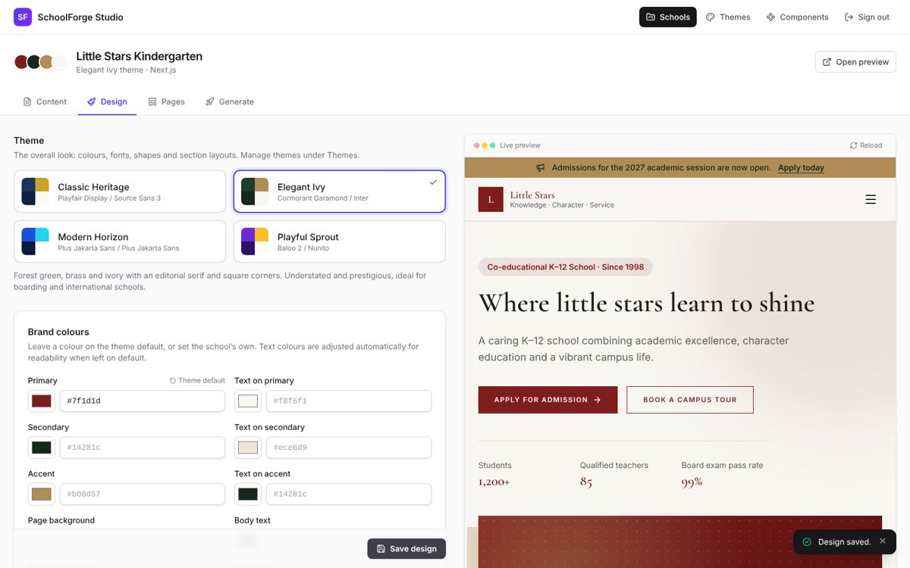

# SchoolForge Studio

A Laravel 13 + Inertia v3 + React app for building school websites. Create a school, fill in its content through the CMS, pick and tune a theme, arrange its pages, preview the real site live, then generate a ready-to-run **Next.js** or **Laravel + Inertia + React** codebase. Themes and components are managed in the same panel.



## Run it

Requirements: PHP 8.3+, Composer, Node.js 20.11+.

```bash
git clone https://github.com/prajwalgiri02/schoolforge && cd schoolforge
composer install
npm install
cp .env.example .env && php artisan key:generate
php artisan migrate --seed          # demo login + the example school
php artisan storage:link            # serves uploaded images
composer run dev                    # web server, queue worker and Vite together
```

Open http://localhost:8000 and sign in as **admin@schoolforge.test** / **password** (from the seeder). Create your own login with `php artisan studio:user you@example.com`.

`composer run dev` starts a queue worker, which runs the code generation. If you start the pieces yourself, also run `php artisan queue:work`.

## What you can do

| Area | What it does |
| --- | --- |
| **Schools** | Create a school from sample content, a template or blank, import an existing `school.config.json`, or download one. Schools can also sign themselves up. |
| **Content** | Edit everything the site says: profile, about, principal, contact, hero banner, announcements, programs, faculty, facilities, gallery, news, events, notices, testimonials, achievements, admissions and FAQs. Lists can be reordered, and images uploaded. |
| **Design** | Choose a theme, override brand colours and Google Fonts, and choose the layout of every section (e.g. hero: overlay, split or centered). |
| **Pages** | Use the automatic site map, or build your own: add pages, and add, remove, reorder and configure sections (components) on each. |
| **Live preview** | Every editor has a live preview of the real website beside it, rendered with the same React components the generated site uses. |
| **Generate** | Write a Next.js or Laravel codebase to any folder, optionally installing dependencies. Generating into the same folder again updates it and keeps any code you edited there by hand. |
| **Themes** | Create themes that extend existing ones; edit colours, fonts, corner radius, heading weight, section layouts and custom CSS. |
| **Components** | Create new section components and edit their layouts and React source code in the browser (local development only). |

Generated Laravel sites include their own admin panel at `/admin`, so a school's staff can keep the content up to date after launch.

## How it fits together

```
app/, resources/js/        Studio (Laravel + Inertia + React)
generator/                 The SchoolForge generator: Node CLI, zero dependencies
  registry/components/     Section components shared by Studio previews and generated sites
  registry/themes/         Themes (theme.json + optional extra.css + component overrides)
  registry/runtime/        Shared UI primitives, types and page renderer
  targets/                 Next.js template and Laravel overlay
```

* Studio stores each school's config in the `projects` table. The config uses the same JSON shape as `school.config.json`.
* Studio never duplicates generator logic. It calls the CLI (`App\Services\Generator`) for validation, previews (`schoolforge preview`), registry data (`schoolforge inspect`) and code generation.
* Previews import the registry components directly. A small Vite plugin (`vite.config.js`) points their framework adapter at `resources/js/preview/adapter.tsx`, and theme tokens are applied as CSS variables, so any theme or colour change shows without rebuilding.
* The content editor uses the same schema (`generator/targets/laravel-inertia-react/files/app/Support/ContentSchema.php`) and React field components as the admin panel inside generated Laravel sites.
* Generation runs as a queued job (`App\Jobs\GenerateSchoolProject`) that streams the CLI output into the run log. Images uploaded in Studio are copied into the generated project.

The generator also works on its own from the command line. See [generator/README.md](generator/README.md).

## Configuration

| `.env` key | Default | Purpose |
| --- | --- | --- |
| `SCHOOLFORGE_OUTPUT_PATH` | `storage/app/generated` | Default folder for generated projects |
| `SCHOOLFORGE_NODE_BINARY` | `node` | Node.js executable used to run the generator |
| `SCHOOLFORGE_TIMEOUT` | `1800` | Seconds a generation (including installs) may take |
| `SCHOOLFORGE_CODE_EDITING` | on when `APP_ENV=local` | Allow editing component source code in the browser |
| `SCHOOLFORGE_HOSTING_DOMAIN` | none | Serve published schools at `<slug>.<domain>` too |
| `SCHOOLFORGE_SERVER_IPS` | addresses of `APP_URL`'s host | This server's public IPs, for checking schools' DNS |
| `SCHOOLFORGE_INVOICE_DAYS_BEFORE` | `14` | Days before a paid period ends that the next invoice is issued |
| `SCHOOLFORGE_BACKUP_DISK` | none | Disk that nightly backups are also copied to |
| `SCHOOLFORGE_GRACE_DAYS` | `14` | Days late before a hosted school shows "temporarily unavailable" |

Keep code editing off on a public server: it lets signed-in users change code that runs in every generated site.

## Running Studio on a server

`compose.yaml` runs everything with one command: Studio, its queue worker and scheduler,
and Caddy for HTTPS. On a server with Docker, point Studio's domain at it, then:

```bash
echo "APP_KEY=$(php artisan key:generate --show)" > .env   # or any base64:… 32-byte key
echo "STUDIO_HOST=studio.example.com" >> .env
docker compose up -d --build
docker compose exec web php artisan studio:user you@example.com --role=owner
```

Schools, uploads, backups and the theme/component registry live in Docker volumes, so
they survive rebuilds. Mail settings (`MAIL_MAILER`, `MAIL_HOST`, …) and the other
settings below can go in the same `.env`.

## Hosting schools

Publishing a school (its **Publish** tab) makes Studio serve it on the school's domain,
rendered to HTML for search engines. Run `npm run build` on the server; it also builds
the renderer (`bootstrap/ssr/ssr.js`). For HTTPS on every school's domain without
configuring each one, put [Caddy](https://caddyserver.com) in front of Studio with
on-demand certificates, which Studio only allows for published schools:

```caddyfile
{
    on_demand_tls {
        ask http://127.0.0.1:8000/hosting/certificate-check
    }
}

studio.example.com {
    reverse_proxy 127.0.0.1:8000
}

https:// {
    tls {
        on_demand
    }
    reverse_proxy 127.0.0.1:8000
}
```

Then point each school's domain (and its `www.`) at the server; **Check DNS and HTTPS**
on the Publish tab shows what is left to do.

### Letting schools sign up

Set `SCHOOLFORGE_SIGNUP=true` and a **Create your school website** link appears on the
sign-in page. A school enters its name and contact details, gets a login for its own
school only, and a short setup (logo, contact details, introduction, principal's message,
theme and colour) leads it to the content editor and the Publish tab.

New schools start from a template so their site already has pages and content to edit:
mark a school as a template, and name it with `SCHOOLFORGE_SIGNUP_TEMPLATE` (its slug).
Without one, the newest template is used, else the example school, renamed.

A new school has a free trial of `SCHOOLFORGE_SIGNUP_TRIAL_DAYS` (default 7) to build and
preview its whole site. To publish, it chooses one of your plans (add monthly and yearly
plans on the Billing page) on its **Package** tab, which issues and emails an invoice with
your `SCHOOLFORGE_PAYMENT_INSTRUCTIONS`. Once you mark the invoice paid on the Billing
page, the school can publish. After the trial, an unpaid school can only open its Package
tab until it pays; nothing it built is lost. Sign-ups show in the Activity log and with a
badge on the Schools page.

## Backups

`php artisan studio:backup` writes a zip of every school, login, uploaded image and the
theme/component registry to `storage/app/private/backups`, and runs nightly when the
scheduler is running (`php artisan schedule:work`, or a cron entry for
`php artisan schedule:run`). Restore with `php artisan studio:backup --restore=path/to/backup.zip`.

To keep a copy on another machine, set `SCHOOLFORGE_BACKUP_DISK` to a filesystem disk
from `config/filesystems.php`: `offsite` writes to a mounted network drive
(`OFFSITE_BACKUP_PATH`, default `/mnt/backups`); `s3` needs
`composer require league/flysystem-aws-s3-v3` and the `AWS_*` settings. The same number
of backups is kept there, and the command fails (so the scheduler reports it) when the
copy cannot be made.

Generated Laravel sites have the same feature as `php artisan school:backup`.

## Deploying generated sites

On the Generate tab, tick **Commit to git** and enter a repository URL. Studio then commits
the codebase and pushes it, ready for Vercel or Netlify (Next.js) or Laravel Cloud or Forge
(Laravel). Each project also has a `DEPLOY.md` with step-by-step guides and a Docker setup.

Existing generated projects can be brought up to date with `schoolforge upgrade`, or by
generating again into the same folder. Files edited by hand are kept.

## Tests

```bash
php artisan test            # Studio (PHPUnit)
npm run test:generator      # generator (node:test)
npm run typecheck           # TypeScript for Studio and the registry
```
