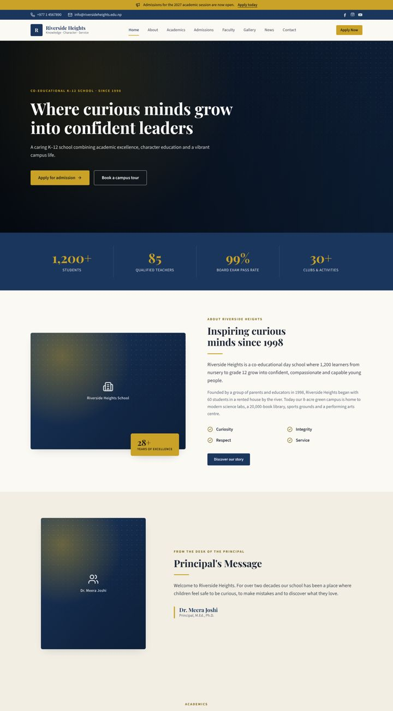
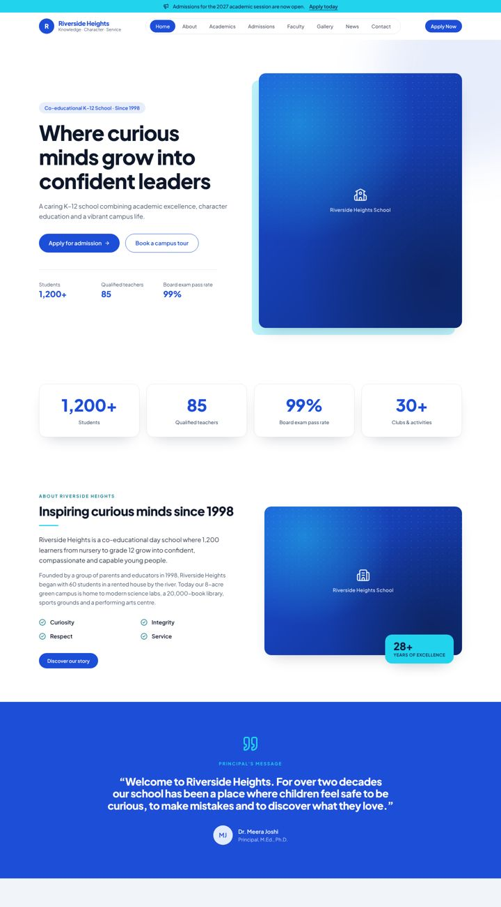
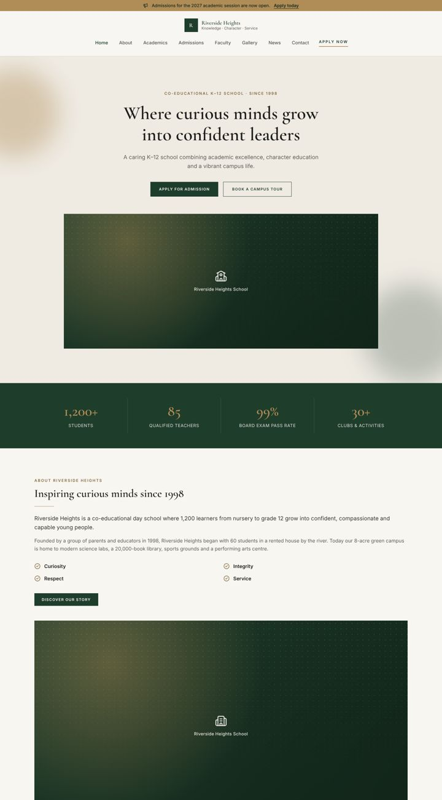

# SchoolForge

Generate a complete, professional **school profile website** from one JSON file, as either a **Next.js** app or a **Laravel 13 + Inertia v3 + React** app.

Describe the school once (name, colours, programs, faculty, news, admissions...), pick a theme, and SchoolForge writes a ready-to-run codebase. Themes and section components live in a registry, so you can add, remove or modify them at any time, both in the registry and inside a generated site.

| Classic Heritage | Modern Horizon | Playful Sprout | Elegant Ivy |
| --- | --- | --- | --- |
|  |  |  |  |

## Quick start

Requirements: Node.js 20.11+. For the Laravel target you also need PHP 8.3+ and Composer.

```bash
git clone <this repo> schoolforge && cd schoolforge
npm link                      # makes the `schoolforge` command available (no dependencies to install)

schoolforge init my-school.json          # answer a few questions (or copy examples/school.config.json)
schoolforge create ../riverside-web --config my-school.json                                   # Next.js
schoolforge create ../riverside-app --config my-school.json --target laravel-inertia-react    # Laravel + Inertia
```

`create` scaffolds the app, installs dependencies (`composer create-project` and `composer require inertiajs/inertia-laravel` for Laravel, then `npm install`) and prints the next steps. Pass `--skip-install` to only write files, `--build` to also run a production build, and `--theme <name>` to override the config.

## What a generated site includes

* **Pages:** Home, About, Academics, Admissions, Faculty, Facilities, Gallery, News & Events, Contact, plus one article page per news item that has a body. Pages without content are left out (no faculty listed means no Faculty page).
* **24 section components:** navbar, announcement bar, hero, stats, about, mission & vision, principal's message, programs, facilities, faculty, gallery (filter + lightbox), news, article, events, notices, testimonials, achievements, admissions, FAQ, call to action, contact (form + map), page header, rich text, footer. Most have 2 or 3 visual variants.
* **A working contact form.** Next.js posts to `/api/contact` and can forward to `CONTACT_WEBHOOK_URL`. Laravel validates with a Form Request, stores enquiries in `contact_messages`, and can email `SCHOOL_CONTACT_RECIPIENT`.
* **Polish:** SEO titles and descriptions, responsive layouts, an accessible mobile menu, skip link, keyboard-navigable lightbox, and themed image placeholders so a site looks finished before photos arrive.
* **Laravel extras:** an admin panel for editing content (see below), PHPUnit feature tests, factories, migrations, and a throttled contact route.

## Admin panel (Laravel target)

Laravel sites include an admin panel at `/admin` where school staff edit content without touching code.

```bash
php artisan school:admin office@school.edu      # create a login (or reset its password)
```

* **What it edits:** school profile, about, principal's message, contact details, social links, home banner, announcement bar, admissions, statistics, programs, facilities, faculty, gallery, news, events, notices, testimonials, achievements and FAQs. Lists support add, remove and reorder.
* **Image uploads** go to `storage/app/public/school` (`php artisan storage:link` runs during `create`).
* **Enquiries:** contact form messages appear in the panel and can be marked read or deleted.
* **How edits are applied:** saved sections are stored in the `site_contents` table and override the generated `site.json`, so changes go live immediately. News stories with a full text get their own page automatically. "Reset to original" drops an edit.
* **Keeping the config in step:** `php artisan school:export-content` writes all admin edits back into `school.config.json`. That way the config stays the source of truth for `schoolforge sync`, theme switches, or regenerating the site. Edits still override the file until they are reset.

Field definitions live in `app/Support/ContentSchema.php`, which drives the forms, validation and storage. Adding a field there adds it to the panel.

Next.js sites have no server-side database, so their content is edited in `school.config.json` followed by `schoolforge sync`.

## The school config

Everything about a school lives in `school.config.json`. See [`examples/school.config.json`](examples/school.config.json) for a full example. [`schema/school.schema.json`](schema/school.schema.json) gives editors autocomplete and validation.

```jsonc
{
    "target": "nextjs",                 // or "laravel-inertia-react"
    "theme": "classic",                 // classic | modern | playful | elegant | your own
    "colors": { "primary": "#7f1d1d" }, // optional brand overrides; readable text colours are derived
    "fonts": { "heading": "Merriweather" },
    "variants": { "hero": "split" },    // optional per-component variant overrides
    "school": { "name": "Riverside Heights School", "tagline": "...", "about": {}, "principal": {}, "contact": {}, "social": {} },
    "hero": {}, "announcement": {}, "stats": [], "programs": [], "facilities": [], "faculty": [],
    "gallery": [], "news": [], "events": [], "notices": [], "testimonials": [], "achievements": [],
    "admissions": {}, "faqs": [],
    "pages": []                         // optional: your own site map (see below)
}
```

Check a config at any time with `schoolforge validate my-school.json`.

### Custom pages

Leave out `pages` to use the default site map in [`registry/presets/default-site.json`](registry/presets/default-site.json). To control it yourself, list pages and the sections on each:

```json
"pages": [
    { "slug": "/", "title": "Home", "sections": [{ "type": "hero", "variant": "split" }, { "type": "stats" }, { "type": "news", "limit": 3 }] },
    { "slug": "/sports", "title": "Sports", "sections": [{ "type": "page-header" }, { "type": "rich-text", "title": "Houses", "paragraphs": ["..."] }] }
]
```

Every section accepts `title`, `subtitle`, `eyebrow`, `variant` and (for lists) `limit`. Components also accept their own options (e.g. `"mode": "full"` on `about`, `"link": false` to hide "view all" buttons).

## Working inside a generated project

Run these from the project root (or pass `--project <dir>`):

| Command | What it does |
| --- | --- |
| `schoolforge sync` | Rebuilds site data, `theme.css` and the component registry from `school.config.json`; updates components to the latest registry version |
| `schoolforge use-theme modern` | Switches theme (tokens, variants, theme-specific components) |
| `schoolforge add faq --page /admissions` | Installs a component and appends it to a page |
| `schoolforge remove testimonials` | Removes the component and every section using it |

**Editing components is safe.** Files under `<school>/components` can be changed freely. `.schoolforge.json` stores the hash of each file SchoolForge wrote, so `sync` notices local edits and keeps them; pass `--force` to overwrite them with the registry version.

**Project-only components:** create `<school>/custom/<name>/index.tsx` (`src/school` for Next.js, `resources/js/school` for Laravel) and run `sync`. The component is registered under `<name>`, can be used as `{ "type": "<name>" }`, and replaces a registry component with the same name.

## Extending the registry

### Add a theme

```bash
schoolforge new theme sunrise --from modern
```

This creates `registry/themes/sunrise/` with:

* `theme.json`: `extends` another theme, so you only override what changes: `tokens.colors`, `tokens.fonts` (Google Fonts are loaded automatically), `tokens.radius`, `tokens.shadow`, `tokens.heading`, and `variants` (which variant each component uses). A theme can also ship its own `pages` and `layout`.
* `extra.css`: optional CSS scoped with `.theme-sunrise`.
* `components/<name>/index.tsx`: optional full replacements of any component, used only by this theme.

Colour tokens: `primary`, `secondary`, `accent`, each with a `*Foreground`, plus `background`, `foreground`, `muted`, `mutedForeground`, `surface` and `border`. They become Tailwind utilities (`bg-primary`, `text-accent-strong`, `rounded-card`, `shadow-card`, `font-heading`...).

### Add a component

```bash
schoolforge new component sports-highlights --variants grid,list
```

This creates `registry/components/sports-highlights/` with `component.json` (label, description, variants, and the content it `requires` to be shown on preset pages) and `index.tsx`. Components receive `{ section, site, page }` and build on the shared primitives in `registry/runtime/ui.tsx` (`Section`, `Container`, `SectionHeading`, `ButtonLink`, `Media`, ...).

Components never import a framework directly. They use `../../adapter` (`Link`, `useCurrentPath`, `submitContact`), which each target implements. That is why one component works in both Next.js and Laravel.

## How it works

```
registry/
  components/<name>/      component.json + index.tsx, shared by both frameworks
  themes/<name>/          theme.json (+ extra.css, + component overrides)
  runtime/                types, UI primitives, icons, page renderer, base CSS
  presets/                default site map
targets/
  nextjs/                 App Router template + Next adapter
  laravel-inertia-react/  overlay for a fresh Laravel app + Inertia adapter
src/                      the CLI (plain Node.js ESM, zero dependencies)
```

`create` and `sync` validate the config and resolve the theme (following `extends`). They then build a normalized `site.json` (pages, resolved variants, navigation and content), generate `theme.css` from the theme tokens, copy the runtime, adapter and used components into the project, and write `registry.ts` mapping section types to components. At runtime a single catch-all route looks up the page by slug and renders its sections. In Next.js this is `app/[[...slug]]` and every page is statically generated. In Laravel it is `SchoolPageController`, which serves the `School/Page` Inertia component.

## Development

```bash
npm test          # generator test suite (node:test)
```

Generated Laravel apps have their own PHPUnit suite: `php artisan test`.
